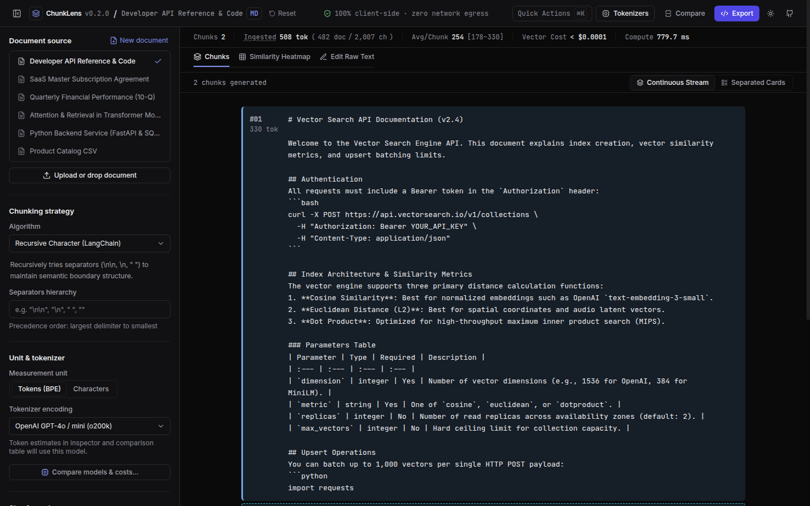

# 🔍 ChunkLens

> **Client-side document chunking and token cost workbench for RAG**  
> *100% Client-Side • Zero Server Egress • Multi-Model BPE Analysis • Open Source (MIT) • Live demo: coming soon*

[](https://opensource.org/licenses/MIT)
[](https://www.typescriptlang.org/)
[](https://react.dev/)
[-emerald.svg)](#-100-client-side-privacy-guarantee)
[](#-architecture--design-standards)

---



---

## 📖 Overview

Retrieval-Augmented Generation (RAG) applications succeed or fail on the quality of their chunking pipeline:
- **Chunks too small:** Crucial context is amputated, degrading semantic retrieval coherence.
- **Chunks too large:** Vector search precision drops, and token ingestion bills escalate.
- **Wrong strategy:** Tabular data loses column headers, markdown headers lose their sections, and code blocks break mid-syntax.

**ChunkLens** is an open-source developer workbench that allows AI and ML engineers to test, inspect, benchmark, and optimize document chunking strategies in real time with exact BPE token calculations, multi-model token variance analysis, and boundary continuity diagnostics—executed entirely inside the browser.

---

## ✨ Key Features

### 1. 5 Production Chunking Algorithms
- 🔄 **Recursive Character (LangChain):** Hierarchical boundary recursion across paragraphs (`\n\n`), lines (`\n`), sentences (`. `), and words.
- 📑 **Markdown Header (Hierarchical AST):** Preserves H1–H6 header paths, section breadcrumbs, and protects fenced code blocks (` ``` `).
- 📊 **Tabular CSV & JSON (Schema-Preserving):** Partitions tabular rows and JSON records while automatically prepending schema column definitions to every chunk to preserve retrieval context.
- 🎯 **Sentence Boundary (LlamaIndex):** Grammatical punctuation-aware boundary splitting with strict overlap retention.
- 🪟 **Fixed-Size Sliding Window:** Strict character or token sliding windows with configurable overlap.

### 2. 6 Frontier Tokenizers Across 5 Model Families
Compare token counts, density ratios, and expansion variances across frontier LLM tokenizer families:
- **OpenAI GPT-4o / mini (`o200k_base`):** 200,000 vocabulary (exact BPE)
- **OpenAI GPT-4 / 3.5 / Ada (`cl100k_base`):** 100,000 vocabulary (exact BPE)
- **Anthropic Claude 3.5 Sonnet:** Calibrated BPE profile (~65k vocabulary)
- **Meta Llama 3 / 3.1 / 3.2:** 128,000 BPE profile
- **Google Gemini 1.5 Pro / Flash:** 256,000 SentencePiece profile
- **Cohere Command R+ / Embed v3:** 256,000 BPE profile
- **Embedding Cost Analyzer:** Estimates real-time vector pipeline costs across OpenAI (`text-embedding-3-small`, `text-embedding-3-large`), Cohere Embed v3, and Voyage AI at 10k and 100k document scale.

### 3. Interactive Visual Canvas & Inspector
- **Continuous Reading Column:** Primary hero view with 8-hue OKLCH chunk color bands and diagonal-hatch overlap ribbons labeled `▨▨ ~X ch overlap with Chunk #Y`.
- **Separated Cards Mode:** Neutral hairline-bordered cards with color-coded left accents.
- **Pro Tool Inspector:** Collapsible 320px sidebar displaying exact character offsets, density ratios (ch/tok), neighbor context, cut reason diagnostics, and severed token warnings.
- **A/B Side-by-Side Comparison:** Compare two chunking configurations on the same document simultaneously.

### 4. Semantic Similarity Heatmap & Continuity Matrix
- **$N \times N$ Pairwise Matrix:** Computes an interactive cosine similarity matrix directly in-browser using L2-normalized TF-IDF vectorization.
- **Boundary Continuity Scoring:** Assesses semantic transition smoothness between neighboring chunks.
- **Redundancy Detection:** Flags duplicate or highly redundant chunk pairs (>70% overlap) with shared key term extraction.

### 5. Document Sniffing & Local Parsing
- **Intelligent Ingestion:** Combines binary magic bytes (`%PDF-`), file extensions, and deep content heuristics to automatically identify uploaded documents.
- **Supported Formats:** PDF (`.pdf`), Markdown (`.md`), Tabular CSV (`.csv`), TSV (`.tsv`), JSON Datasets (`.json`), JSON Lines (`.jsonl`), Source Code (`.py`, `.ts`, `.js`, `.go`, `.sql`), and Plain Text.
- **Auto Strategy Alignment:** Uploading a CSV or JSON file automatically switches the workbench to **Tabular Record Chunking**; uploading Markdown aligns to **Markdown Header Splitting**.

### 6. One-Click Production Code & Dataset Exporter
Generates copy-pasteable, production-ready code mirroring your exact in-browser parameters:
- **Python (LangChain):** `RecursiveCharacterTextSplitter`, `MarkdownHeaderTextSplitter`
- **Python (LlamaIndex):** `SentenceSplitter`, `TokenTextSplitter`
- **TypeScript (LangChain.js):** Browser and Node.js compatible
- **Native Python:** Zero external dependencies
- **Dataset Export:** Download chunks as JSON or RFC 4180 CSV with token counts, character offsets, and metadata.

---

## 🔒 100% Client-Side Privacy Guarantee

ChunkLens operates entirely within your browser runtime:
- **Zero Network Egress:** All text parsing, BPE tokenization, and vector similarity calculations execute locally.
- **Strict Content Security Policy:** Production builds enforce `connect-src 'none'`, preventing any outbound network requests.
- **Isolated PDF Parsing:** Client-side Web Worker parses PDF documents locally via `pdfjs-dist` with script evaluation disabled (`isEvalSupported: false`).
- **Memory Safety:** Cloned buffer protection prevents memory leaks and detached buffer errors during binary file processing.
- **Zero Cookies / Zero Telemetry:** No tracking, no analytics, no external CDN font calls, and no local storage persistence of your document text.

### DevTools Privacy Verification Guide
You can independently verify the zero-egress guarantee at any time:
1. Open your browser Developer Tools (`F12` or `Cmd+Option+I` / `Ctrl+Shift+I`).
2. Switch to the **Network** tab.
3. Upload any sensitive document, change chunking strategies, or inspect token counts.
4. Verify that **zero network requests** are dispatched during parsing, chunking, or analysis.
5. In the **Console** or **Security** tab, inspect the document headers or meta tags to verify the active Content Security Policy: `connect-src 'none'`.

---

## ⚠️ Architectural Limitations

- **Browser Heap Limits:** Because all processing runs client-side in the browser tab, extremely large files (>50 MB) or documents containing hundreds of pages may be limited by available browser memory.
- **Scanned / Rasterized PDFs:** PDF extraction extracts text streams embedded directly in the document. Scanned images or rasterized PDFs without an embedded OCR text layer will not produce text (OCR engines are excluded to maintain a lightweight, instant bundle).

---

## ⌨️ Keyboard Shortcuts

| Shortcut | Action |
| :--- | :--- |
| `⌘K` / `Ctrl+K` | Open Command Palette (search strategies, corpora, views) |
| `[` | Toggle Left Configuration Sidebar |
| `]` | Toggle Right Chunk Inspector |
| `J` / `ArrowRight` | Step to next chunk |
| `K` / `ArrowLeft` | Step to previous chunk |
| `C` | Copy selected chunk text |
| `Esc` | Clear chunk selection / Dismiss dialogs |

---

## 🚀 Getting Started

### Prerequisites
- Node.js >= 20.0 (or Node.js 22 LTS)
- npm >= 9.0

### Run Locally
```bash
# 1. Clone repository
git clone https://github.com/Dhanesh10war/chunklens.git
cd chunklens

# 2. Install dependencies
npm install

# 3. Start local development server
npm run dev
```
Visit `http://localhost:5173` in your browser.

### Verification & Build
```bash
# Run strict TypeScript type check
npm run typecheck

# Run test suite
npm test

# Production build with bundle budget checks
npm run build
```

---

## 📐 Architecture & Technology Stack

```
┌──────────────────────────────────────────────────────────────┐
│                    Client Browser Runtime                    │
├──────────────────────────────┬───────────────────────────────┤
│ UI Framework                 │ React 18 + TypeScript + Vite  │
│ Design Tokens                │ Tailwind CSS + OKLCH Theme    │
│ Icons & Feedback             │ Lucide Icons + Native Toasts  │
├──────────────────────────────┼───────────────────────────────┤
│ Off-Thread Processing        │ Background Web Worker         │
│ Tokenization Engine          │ js-tiktoken (BPE o200k/cl100k)│
│ Similarity & Vectorizer      │ In-Memory TF-IDF + Cosine Sim │
│ PDF Extraction               │ pdfjs-dist (Isolated Worker)  │
│ Format Sniffer               │ Magic Bytes & Content Parser  │
└──────────────────────────────┴───────────────────────────────┘
```

---

## 📄 License

Licensed under the [MIT License](./LICENSE). Created by [Dhaneshwar](https://github.com/Dhanesh10war).
